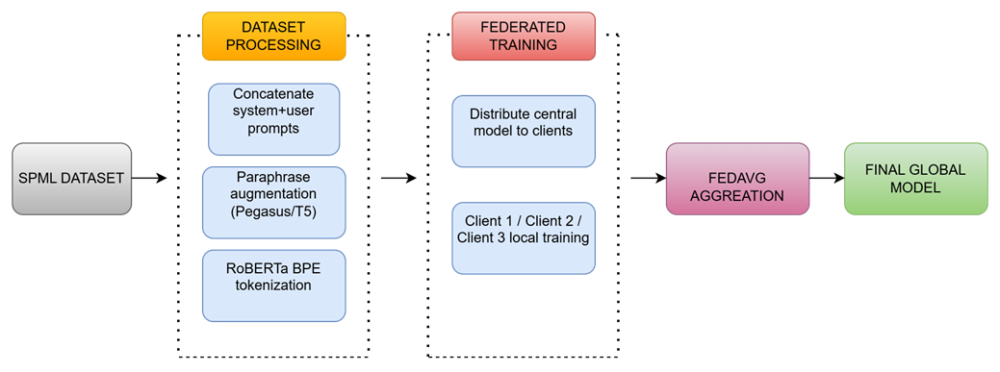

# Detecting Adversarial Prompts in Healthcare Chatbots

Detection of adversarial (malicious) prompts aimed at healthcare chatbots, using a fine-tuned **RoBERTa** classifier. The project compares **centralized training** against **federated learning (FedAvg)** under both IID and non-IID data distributions, to see whether a detector can be trained across several parties without pooling their prompt data.

## Overview

Healthcare chatbots handle sensitive medical information, which makes them a target for prompt-based attacks such as instruction overrides, jailbreaks and attempts to extract private data. This project builds a binary classifier that labels an incoming prompt as **benign (0)** or **malicious (1)**.

It covers three setups:

| Setup | Description |
| ----- | ----------- |
| **Centralized** | One RoBERTa model trained on the full training set (baseline) |
| **Federated, IID** | Training data split evenly and randomly across 3 simulated clients |
| **Federated, non-IID** | Training data split across 3 clients with a Dirichlet label skew (alpha = 0.3) |

## Method

1. **Data:** each sample combines the chatbot's system prompt and the user prompt into a single text input (`system_prompt + user_prompt`) with a binary label.
2. **Split:** stratified 80% train / 10% validation / 10% test (seed 42).
3. **Model:** `roberta-base` fine-tuned for sequence classification (2 classes), max length 256.
4. **Centralized training:** AdamW with linear warmup/decay, class-weighted cross-entropy loss to handle label imbalance, gradient clipping, and best-checkpoint selection on validation F1.
5. **Federated training:** sample-weighted **FedAvg** across 3 clients, 4 communication rounds and 3 local epochs per round. Raw data stays on each client, and only model weights are aggregated.
6. **Evaluation:** accuracy, precision, recall, F1 and AUC-ROC on a held-out test set, with confusion matrices, ROC curves and loss/accuracy-vs-round plots.

### Hyperparameters

| Parameter | Value |
| --------- | ----- |
| Model | roberta-base |
| Max sequence length | 256 |
| Batch size | 8 |
| Learning rate | 2e-5 |
| Epochs (centralized) | 3 |
| Federated clients | 3 |
| Federated rounds / local epochs | 4 / 3 |
| Non-IID Dirichlet alpha | 0.3 |
| Random seed | 42 |

## Repository contents

```
├── Detecting_Adversarial_Prompts_in_Healthcare_Chatbots_clean.ipynb   # Main notebook (run this)
├── Detecting Adversarial Prompts in Healthcare Chatbots.py            # Same code exported as a script
└── image.png                                                           # Result figure
```

## Getting started

### 1. Install dependencies

```bash
pip install torch transformers datasets scikit-learn pandas numpy matplotlib seaborn
```

### 2. Add the dataset

Place `combined_healthcare_prompts_mini.csv` in the working directory. It must contain these columns:

| Column | Description |
| ------ | ----------- |
| `System Prompt` | The chatbot's system prompt |
| `User Prompt` | The user's message |
| `Label` | 0 = benign, 1 = malicious |

### 3. Run

Open the notebook in Jupyter or Google Colab (a GPU is recommended) and run all cells in order. Alternatively, run the exported script:

```bash
python "Detecting Adversarial Prompts in Healthcare Chatbots.py"
```

## Results

Test-set results (fill in from your final run):

| Model | Accuracy | Precision | Recall | F1 | AUC-ROC |
| ----- | -------- | --------- | ------ | -- | ------- |
| Centralized | - | - | - | - | - |
| Federated (IID) | - | - | - | - | - |
| Federated (non-IID) | - | - | - | - | - |



## Tech stack

Python, PyTorch, Hugging Face Transformers and Datasets, scikit-learn, pandas, NumPy, Matplotlib, Seaborn.

## Limitations and future work

- Federated learning is **simulated** on a single machine, not run across real distributed clients.
- Only 3 clients and 4 rounds were tested, and no privacy mechanisms such as differential privacy or secure aggregation are applied.
- The dataset is a small combined set of healthcare prompts, so results may not generalize to unseen attack styles.
- Planned next steps: evaluating on external attack datasets, adding explainability, and integrating the detector into a RAG pipeline (see [HEPID-Healthcare-RAG-Security](https://github.com/alphin20/HEPID-Healthcare-RAG-Security)).

## Author

**Alphin Kayalathu Mathew**
M.Tech, Amrita Vishwa Vidyapeetham, Amritapuri Campus
GitHub: [@alphin20](https://github.com/alphin20)
