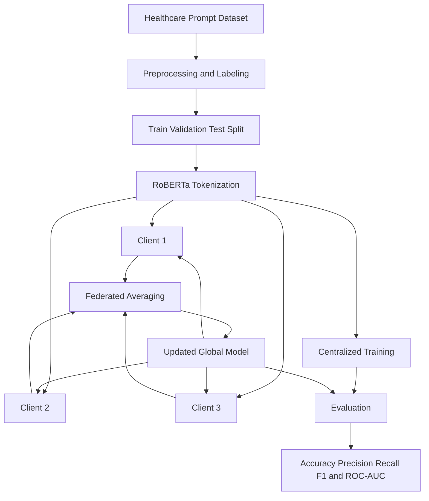

# Privacy-Preserving Detection of Adversarial Prompts in Healthcare Chatbots

**A Transformer-Based Cybersecurity Framework Using Federated Learning**

[](https://www.python.org/)
[](https://pytorch.org/)
[](https://huggingface.co/docs/transformers/)
[]()
[]()

## Overview

Healthcare chatbots powered by Large Language Models (LLMs) can help users access medical information, but they may also be exposed to adversarial prompts and prompt-injection attempts. Such inputs can manipulate model behavior, interfere with intended instructions, or attempt to bypass safety controls.

This project investigates a **privacy-aware, transformer-based approach to detecting malicious prompts in healthcare chatbot workflows**.

A fine-tuned RoBERTa classifier distinguishes benign prompts from malicious prompts. The project evaluates conventional centralized training alongside a simulated federated learning framework in which multiple clients train locally and a central server aggregates model parameters using Federated Averaging (FedAvg).

The objective is to study whether federated training can achieve competitive malicious-prompt detection performance while avoiding the need to pool raw client training examples in the simulated setup.

> **Research prototype:** This project focuses on prompt classification and experimental evaluation. It is not a clinically validated system and does not guarantee protection against all prompt-injection attacks.

## Key Features

- **Adversarial prompt detection:** Binary classification of benign and malicious prompts.
- **Transformer-based classification:** Fine-tuning RoBERTa for contextual text understanding.
- **Federated learning:** Simulated multi-client training using FedAvg.
- **IID and Non-IID experiments:** Evaluation under different client data distributions.
- **Performance evaluation:** Accuracy, precision, recall, F1-score, and ROC-AUC.
- **Reproducible experimentation:** Documented model configuration and training workflow.
- **Privacy-aware design:** Raw client training examples are not centrally pooled during the simulated federated training process.

## Problem Statement

Healthcare LLM applications may encounter prompts that contain malicious instructions, attempts to override system guidance, or other adversarial content.

A conventional centralized machine-learning workflow collects training data into a single location. In healthcare-related applications, centralizing data may create additional privacy and governance challenges.

This project investigates two related questions:

1. Can a transformer-based classifier distinguish malicious prompts from benign healthcare-related prompts?
2. How does simulated federated learning compare with centralized training when clients have independently partitioned data?

## Proposed Architecture



*The federated workflow represents a simulated multi-client experiment. Clients run within the experimental environment; this is not evidence of deployment across independent healthcare institutions.*

## Methodology

### 1. Dataset Preparation

The project uses a healthcare-focused subset of a prompt-injection dataset, with preprocessing and augmentation to prepare examples for binary classification.

The previously documented augmented dataset contains:

| Class | Number of samples |
|---|---:|
| Benign | 2,949 |
| Malicious | 4,294 |
| **Total** | **7,243** |

The class distribution is imbalanced, with malicious examples representing the larger class.

**Data preparation workflow**

- Identify healthcare-relevant prompts.
- Combine relevant prompt fields where applicable.
- Normalize and preprocess text.
- Assign benign or malicious labels.
- Apply documented paraphrase augmentation.
- Partition data for training, validation, and testing.

Dataset counts may change if filtering, deduplication, augmentation, or labeling is modified. Report the final counts generated by the actual preprocessing pipeline.

**Important:** Split original examples before augmentation whenever possible. Keep paraphrases of the same original prompt within the same partition to reduce data leakage.

### 2. Text Representation and Classification

RoBERTa is used as the primary transformer architecture for contextual text classification.

The input text is tokenized and passed to a sequence-classification model that predicts one of two classes:

- **Benign:** No malicious prompt behavior is identified by the classifier.
- **Malicious:** The input is classified as potentially adversarial.

A classification result is a model prediction, not a guarantee that an input is safe or harmful.

### 3. Centralized Training

The centralized baseline trains a RoBERTa classifier using the designated centralized training partition.

This provides a reference point for comparing model performance with federated training.

### 4. Federated Learning

The federated experiment uses three simulated clients and Federated Averaging (FedAvg).

At each communication round:

1. The current global model is distributed to the clients.
2. Each client trains locally on its assigned partition.
3. Client model parameters are returned to the aggregation process.
4. FedAvg combines the client updates into a new global model.
5. The updated model is evaluated according to the experimental protocol.

The experiments investigate both:

- **IID distribution:** Client data is partitioned to approximate similar distributions.
- **Non-IID distribution:** Client data is partitioned to represent heterogeneous data distributions.

Federated learning in this implementation is simulated. Differential privacy, secure aggregation, and formal privacy guarantees are not implemented unless explicitly added to the code.

## Experimental Configuration

The documented experimental configuration is summarized below.

| Parameter | Configuration |
|---|---|
| Primary model | RoBERTa-base |
| Task | Binary text classification |
| Number of clients | 3 |
| Federated aggregation | FedAvg |
| Federated communication rounds | 4 |
| Local epochs per round | 3 |
| Batch size | 8 |
| Learning rate | 2 × 10⁻⁵ |
| Maximum sequence length | Verify against final training configuration |
| Optimizer | AdamW |
| Training environment | Google Colab with Tesla T4 GPU in the reported experiments |

If the final notebook uses different values, update this table to match the configuration that generated the published results.

## Evaluation Metrics

The centralized and federated models should be evaluated using the same held-out test set and consistent metric definitions.

| Metric | Purpose |
|---|---|
| Accuracy | Overall proportion of correct predictions |
| Precision | Proportion of predicted malicious examples that are actually malicious |
| Recall | Proportion of actual malicious examples detected |
| F1-score | Harmonic mean of precision and recall |
| ROC-AUC | Ability to rank positive and negative examples across classification thresholds |

For cybersecurity applications, recall and false-negative rates are especially important because missed malicious prompts can remain undetected.

Accuracy should not be interpreted in isolation, particularly when classes are imbalanced.

## Results

Populate this table using the final verified evaluation outputs.

| Model | Accuracy | Precision | Recall | F1-score | ROC-AUC |
|---|---:|---:|---:|---:|---:|
| Centralized RoBERTa | Add result | Add result | Add result | Add result | Add result |
| Federated RoBERTa — IID | Add result | Add result | Add result | Add result | Add result |
| Federated RoBERTa — Non-IID | Add result | Add result | Add result | Add result | Add result |

### Results reporting guidelines

- Use the same test set for comparable model configurations.
- Clearly state which class is treated as positive.
- Report the dataset split and evaluation procedure.
- Include confusion matrices and ROC curves where available.
- Report results across multiple random seeds when feasible.
- Use confidence intervals or standard deviations to characterize uncertainty.
- Do not use the final test set to select classification thresholds.

No result should be interpreted as evidence of generalization to unseen attacks unless the evaluation explicitly tests such attacks.

## Repository Structure

The following is an illustrative structure. Adjust it to match the actual files in this repository.

```text
Detecting-Adversarial-Prompts-in-Healthcare-Chatbots/
├── notebooks/
│   └── federated_prompt_detection.ipynb
├── data/
│   └── README.md
├── results/
│   ├── metrics.csv
│   ├── confusion_matrix.png
│   └── roc_curve.png
├── requirements.txt
├── README.md
└── LICENSE
```

Only include files and paths that actually exist. If the notebook is stored in the repository root, document its real location rather than creating a fictional directory structure.

## Installation

Clone the repository:

```bash
git clone https://github.com/alphin20/-Detecting-Adversarial-Prompts-in-Healthcare-Cha.git
cd -Detecting-Adversarial-Prompts-in-Healthcare-Cha
```

Create and activate a virtual environment:

```bash
python -m venv .venv
```

Windows:

```powershell
.venv\Scripts\activate
```

Linux or macOS:

```bash
source .venv/bin/activate
```

Install dependencies:

```bash
pip install -r requirements.txt
```

If `requirements.txt` is not present, create it from the packages actually required by the notebook and test installation in a clean environment before publishing these instructions.

## Running the Project

The notebook-based workflow is:

1. Open the training notebook in Jupyter or Google Colab.
2. Configure the dataset path.
3. Execute the preprocessing and dataset-splitting cells.
4. Train the centralized RoBERTa baseline.
5. Run the federated training experiment.
6. Evaluate the resulting models on the designated test set.
7. Export the metrics and evaluation plots.

Dataset acquisition and checkpoint paths must be configured according to the actual files and instructions in the repository.

## Security and Privacy Considerations

This project is an experimental defense mechanism and should be interpreted within the following limitations:

- A binary classifier may fail to recognize novel or obfuscated attacks.
- Benign inputs can be incorrectly flagged, while malicious inputs can be missed.
- Prompt-injection detection is not a complete substitute for secure LLM architecture and tool permissions.
- Federated learning does not inherently prevent information leakage from model updates.
- The simulated setup does not demonstrate real-world deployment across healthcare organizations.
- The system has not been established as clinically validated or suitable for processing real patient data.

A production deployment would require additional testing, secure aggregation or other appropriate privacy mechanisms, robust access controls, monitoring, threat modeling, and independent security validation.

## Future Improvements

Potential extensions include:

- Evaluation on additional independently sourced prompt-injection datasets.
- Testing against indirect injection and previously unseen attack patterns.
- Robustness testing against paraphrasing, obfuscation, and multilingual inputs.
- Improved calibration and threshold selection based on security requirements.
- Multiple-run statistical analysis and confidence intervals.
- Differential privacy and secure aggregation experiments.
- Explainable AI techniques for identifying suspicious text segments.
- Integration with a pre-LLM security gateway.
- End-to-end testing within a healthcare RAG application.

These are future directions and should not be interpreted as implemented features unless the corresponding code and experiments are available.

## Research Contribution

This project provides an experimental investigation of transformer-based adversarial prompt detection and federated learning for healthcare chatbot security.

It connects natural language processing, adversarial input detection, distributed model training, and cybersecurity evaluation within a healthcare-focused use case.

The main research objective is to understand the effectiveness and limitations of these approaches under centralized and heterogeneous multi-client training conditions.

## Author

**Alphin Kayalathu Mathew**

M.Tech in Cybersecurity and Network Systems  
Amrita Vishwa Vidyapeetham, Amritapuri Campus

- GitHub: [@alphin20](https://github.com/alphin20)

## Disclaimer

This repository is intended for academic research and educational purposes. It is not a medical diagnostic system, does not provide medical advice, and does not guarantee detection or prevention of all adversarial prompts.

Use only datasets and test environments for which you have appropriate permission.

---

If you use this work in academic research, please cite the repository and any associated publication when available.

